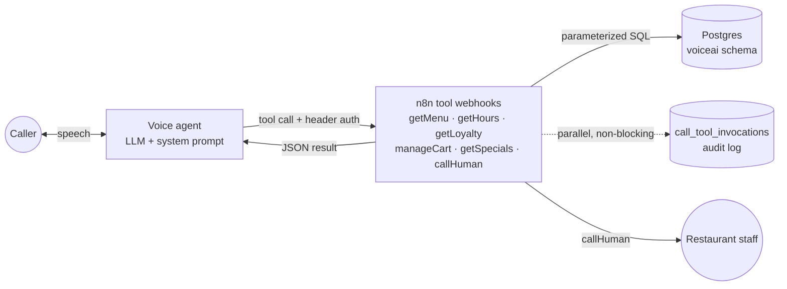

# Restaurant Voice Ordering Agent

**An AI phone agent that takes restaurant orders using only live menu data, and hands every confirmed order to a human.** Built with n8n, PostgreSQL (Supabase) and a voice platform (OmniDimension).

`66 nodes · 6 tool webhooks · 12-table Postgres schema`

## The pain point
At peak hours the restaurant phone line rings out. Staff who should be cooking spend their time reading out prices, spice levels and allergens. A voice bot that guesses a price, forgets "no peanuts", or places an order nobody checked is worse than a missed call.

## What I built
A voice agent ("Riya") that:
- tells callers whether the branch is open and when it next opens
- recognises returning loyalty customers by phone number
- answers menu questions (dishes, prices, dietary tags, spice levels, allergens, bestsellers) **from the database only**
- builds and edits a cart, mentions active promotions once, and captures every special instruction **verbatim**
- reads back the full order, gets explicit confirmation, then **hands off to a human** with a structured summary

### Every tool follows the same shape
`Webhook → Parse input → Resolve branch & ensure call row → Business query → Format success/error → Respond` and, in parallel, `→ Log invocation`

The branch is resolved from **the number the caller dialled**, so one backend serves every outlet.

## Guardrails and design decisions
| Risk | What I did |
|---|---|
| The agent invents a price or dish | Grounding rule: the agent must call a tool and speak only fields from the result |
| Allergy notes get lost | Special instructions are captured verbatim, carried through the call and saved to their own table, de-duplicated |
| Orders placed without a check | No auto-submission: `callHuman` saves the summary and transfers the caller to staff |
| "What did the bot tell me?" disputes | Every tool call (args, result, success) is logged with an idempotent key; logging runs **in parallel** so it never slows the caller |
| Prices change mid-order | Cart lines snapshot the name and unit price when added; `line_total` is a generated column |
| Bad input from the LLM | Parameterized SQL, type casts (`::uuid`, `::int`), phone validated in code **and** by a DB `CHECK` constraint |
| Flaky lookups | `retryOnFail` (2 tries, 500 ms) on live queries; a uniform `{success, error_code, message}` contract so the agent always knows what happened |
| Abuse of the webhooks | Header auth on all six endpoints |
| Angry callers or safety issues | Immediate human escalation for anger, manager requests, health/safety issues or repeated tool failures |

## Database
12 tables in the `voiceai` schema. See [`docs/SCHEMA.md`](docs/SCHEMA.md).

## Run it yourself
1. Create the `voiceai` schema (see `docs/SCHEMA.md`) in Postgres or Supabase and load a few fake menu rows ([`sample/menu_items.csv`](sample/menu_items.csv)).
2. Import `workflows/voice-agent-tools.json` into n8n.
3. Connect your Postgres and Header Auth credentials and set `GENERAL_SUPPORT_PHONE_NUMBER`.
4. Register the six webhook URLs as tools in your voice platform, sending the same auth header.
5. Call it and try: "What's vegetarian and not spicy?", "Add two of those", "No onions please".

## Known limitations / next steps
- No POS integration yet; a human finalises every order.
- Order totals and promotions are applied by staff, not computed automatically.
- Call-end bookkeeping (duration, outcome) isn't wired up yet.
- A shared webhook secret covers all six tools; per-tool keys and Supabase RLS are next.
- PII (phone, address, notes) is stored in plain text; column encryption is on the roadmap.

---
Built by **Vennela Davunuri**, AI Automation Engineer · [All my workflows](https://github.com/venneladavunuri98-cloud/n8n-ai-workflows) · [Portfolio](https://portfolio-vennela3.vercel.app) · [LinkedIn](https://www.linkedin.com/in/venneladavunuri/)
